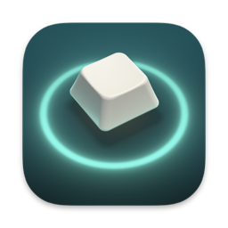

# Halo Deck

### Configure a NuPhy Halo96 V1 from your Mac.

NuPhy's configurator for the Halo96 V1 only runs on Windows. Halo Deck is a
native macOS app that does the same job over the keyboard's USB connection.

**[⬇︎ Download for macOS](https://github.com/obalabs/halodeck-releases/releases/latest)**  ·  macOS 15+ · Apple Silicon and Intel · signed & notarized · free

 

## What it does

- **Lights.** Backlight effect, brightness, speed and colour for the Mac and Win
  layers, the halo underglow, the side light bar, and key debounce.
- **Per-key colours.** Paint individual keys and apply them as the Custom effect.
- **Keys.** Remap any key on the Mac or Win layer to another key, a modifier
  combination, a media key or a macro.
- **Macros.** Edit all eight macro slots, long delays included.
- **Backups.** Every change is preceded by a backup of the keyboard's settings.
  Restore or export one from the Device screen.

Every colour is shown with its name and hex value, so nothing depends on telling
colours apart.

## Before you start

- **Halo96 V1 only.** The V2 uses VIA in the browser and is not supported.
- **Wired mode.** Set the switch to wired and plug in the USB-C cable. Settings
  can't be changed over Bluetooth or the 2.4 GHz receiver. They stay on the
  keyboard after you unplug it.
- **Input Monitoring.** macOS asks for it on first launch. You can also grant it
  in System Settings → Privacy & Security.
- **Halo changes need a nudge.** The keyboard saves a new halo setting but keeps
  showing the old one until you press Fn+H down and then up, or replug the cable.
- **Battery.** No app can read the battery level. Press Fn+N to see it on the
  side light bar.

## Safety

Halo Deck only sends commands that have been checked against a real keyboard,
and refuses anything else. It never touches firmware. Even so, it is an
unofficial tool: use it at your own risk, and keep the backup it makes.

## Feedback

Found a bug or have a request? [Open an issue](https://github.com/obalabs/halodeck-releases/issues).

---

Made by [OBA Labs](https://obalabs.app). Not affiliated with or endorsed by
NuPhy. The protocol work builds on
[mishamyrt/nuga-lib](https://github.com/mishamyrt/nuga-lib) and
[donn/nudelta](https://github.com/donn/nudelta). The source code is private.
